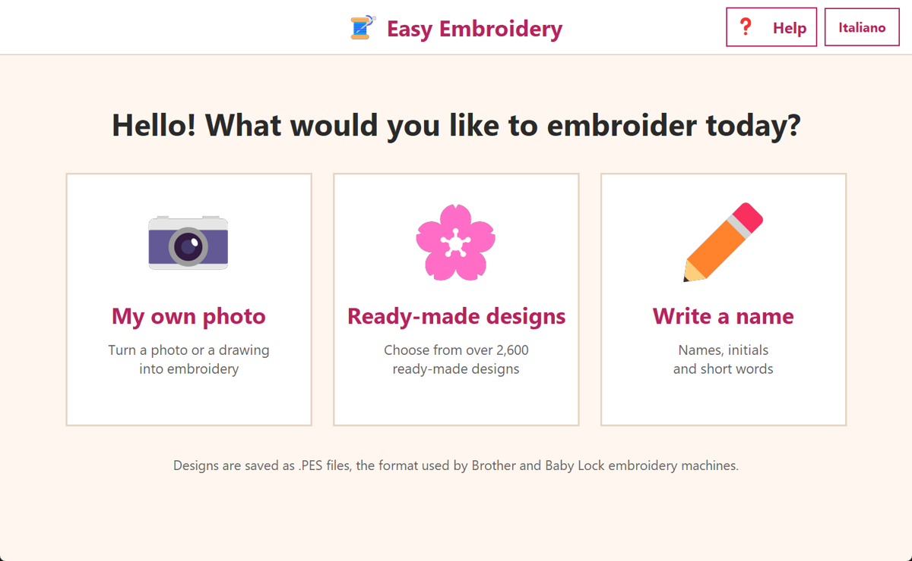
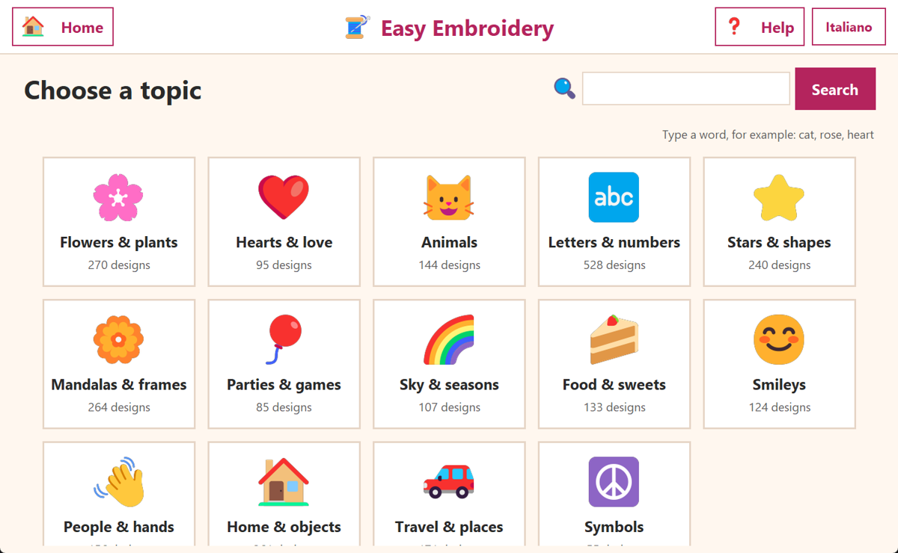
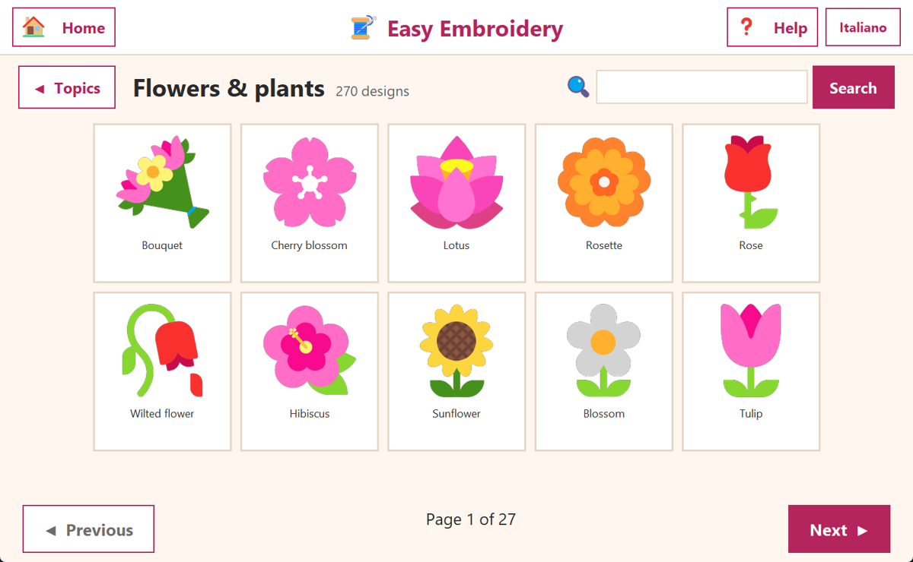
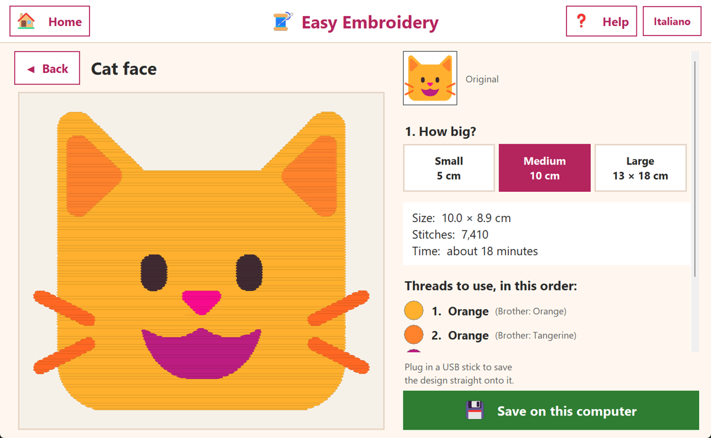
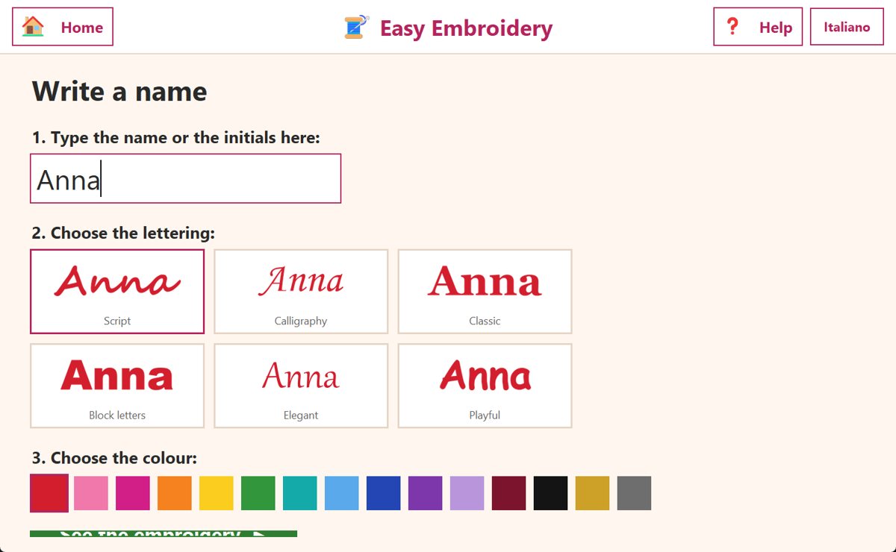

<div align="center">


# Ricamo Facile — Easy Embroidery

**Turn photos, drawings and names into designs for your embroidery machine, in a few clicks.**

[🇮🇹 Italiano](README.md) · 🇬🇧 English

[**⬇️ Download Ricamo Facile for Windows**](https://github.com/Lucosh/ricamo-facile/releases/latest/download/RicamoFacile.exe)

</div>

---

Ricamo Facile is a Windows program for people who **aren't comfortable with computers**.
It has big buttons, large text, only a few choices at a time and no technical words.
It creates **.PES** files, the format used by **Brother** and **Baby Lock** embroidery machines.
The interface is available in **Italian and English** (one click on the button at the top right).

<p align="center">
  
</p>

## What you can do

| | |
|---|---|
| 📷 **My own photo** | Pick a photo or a drawing from your computer: the program turns it into embroidery, removes the background on its own and shows how it will look, stitch by stitch. |
| 🌸 **Ready-made designs** | A catalogue of **more than 2,500 designs** in 14 topics: flowers, hearts, animals, letters, mandalas, parties, food, seasons and much more. You can also search by word ("cat", "rose", "christmas"…). |
| ✏️ **Write a name** | Type a name or initials, then pick one of up to 6 lettering styles and 15 colours. |
| 💾 **Save to the USB stick** | When a USB stick is plugged in, a big green button appears to save the design straight onto it. |

<p align="center">
  
  
</p>
<p align="center">
  
  
</p>

## Installation

1. Click [**Download Ricamo Facile for Windows**](https://github.com/Lucosh/ricamo-facile/releases/latest/download/RicamoFacile.exe).
2. Open the downloaded `RicamoFacile.exe`. Nothing else needs to be installed.
3. The first time, Windows may show a blue warning ("Windows protected your PC"). This is normal for free programs without a digital signature. Click **More info**, then **Run anyway**.

> 💡 Setting it up for a parent or grandparent? Drag `RicamoFacile.exe` onto the Desktop so a double-click is all it takes to open it.

Works on **Windows 10 and Windows 11**.

## How to use it

1. On the home page choose what to embroider: **your own photo**, **a ready-made design** or **a name**.
2. Choose the size: **Small** (5 cm), **Medium** (10 cm) or **Large** (13 × 18 cm).
   The left side shows right away how the embroidery will look.
3. On the right you'll find the **size**, the **number of stitches**, the **time** and the list of **threads to use, in order**.
4. Plug in the USB stick and press the green **Save to the USB stick** button.
5. Put the stick into the embroidery machine and pick the file.

The **Help** button at the top repeats these steps at any time, and **Home** always takes you back to the first page.

## Tips for good results

- **Simple pictures** work best: drawings, logos, flowers, cartoon animals, with **few colours** and a **plain, light background**.
- Photos of faces or busy landscapes end up as "patches of colour". That's a limit of embroidery itself, not of the program.
- For photos you can choose **how many colours** to use: "Few" gives a cleaner result, "Many" a more detailed one.
- Always try the design on a **scrap of fabric** with stabiliser before stitching the real garment.
- Choose **Large** only if your machine has a 13 × 18 cm hoop.

## FAQ

**Which machines does it work with?**
Embroidery machines that read `.PES` files: Brother, Baby Lock and many compatible models. Files are written as PES version 6, which also includes the PEC section that the machines read directly.

**Does it need the internet?**
No. The program works completely offline and sends no data anywhere.

**Where are the settings stored?**
The chosen language and the last folders used are kept in `%APPDATA%\RicamoFacile`. If something goes wrong, an `errori.log` file is saved there too.

**Do the thread colours have to match exactly?**
No. Each colour has a simple name (e.g. "Red") and the name of the closest Brother thread. Use whichever thread you like.

---

## For developers

### Run from source

You need Python 3.10 or newer on Windows.

```bat
git clone https://github.com/Lucosh/ricamo-facile.git
cd ricamo-facile
pip install -r requirements.txt
python RicamoFacile.pyw
```

### Build the executable

```bat
build.bat
```

This creates `dist\RicamoFacile.exe` with PyInstaller. It's a single file of about 30 MB.

### Tests

```bat
pip install -r requirements-dev.txt
python -m pytest
```

### How the conversion works

1. **Colours**: photos use *median cut* colour reduction. Catalogue designs and lettering keep the exact flat colours of the drawing and ignore anti-aliased edge pixels.
2. **Background**: pixels that are close to the border colour and connected to the border are removed. The subject is then cropped and scaled to fill the chosen hoop.
3. **Clean-up**: the image is mapped onto a 0.2 mm grid. A mode filter removes speckles, and colours too small to sew are merged into the closest one.
4. **Stitches**: each colour is filled with **tatami fill stitches**. Rows are 0.4 mm apart and stitches are 3 mm long and staggered. Pull compensation is added, and touching rows are chained together to keep jumps and trims to a minimum.
5. **File**: the design is written as PES v6 with [pyembroidery](https://github.com/EmbroidePy/pyembroidery), with tie-in and tie-off stitches on every section.

### Project layout

```
RicamoFacile.pyw           program entry point
ricamo_facile/
  app.py                   window and screens (tkinter)
  converter.py             picture → stitches → .PES file
  library.py               design catalogue and search
  shapes.py                generated designs: hearts, stars, flowers, mandalas, letters…
  threads.py               Brother thread colours and simple colour names
  i18n.py                  Italian and English texts
  data/emoji.json          emoji names and categories (IT/EN)
tools/
  build_emoji_db.py        rebuilds data/emoji.json from Unicode data
  make_icon.py             creates the icon
  screenshots.py           creates the screenshots on this page
tests/                     automated tests
```

### Where the catalogue designs come from

- **About 1,200 designs** are Windows colour emoji (the *Segoe UI Emoji* font). They are not shipped with the program: they are drawn on the fly from the font already on the computer. Italian names and categories come from [Unicode CLDR](https://cldr.unicode.org/) data ([Unicode licence](https://www.unicode.org/license.txt)).
- **About 1,400 designs** are generated by the program: hearts, stars, flowers, leaves, mandalas, frames, snowflakes, butterflies, geometric shapes, and letters and numbers in 6 lettering styles. Each comes in several colours. Monotype Corsiva is only available when Microsoft Office is installed.

## Licence

[MIT](LICENSE): you are free to use, change and share the program.
