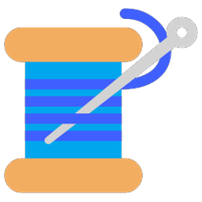
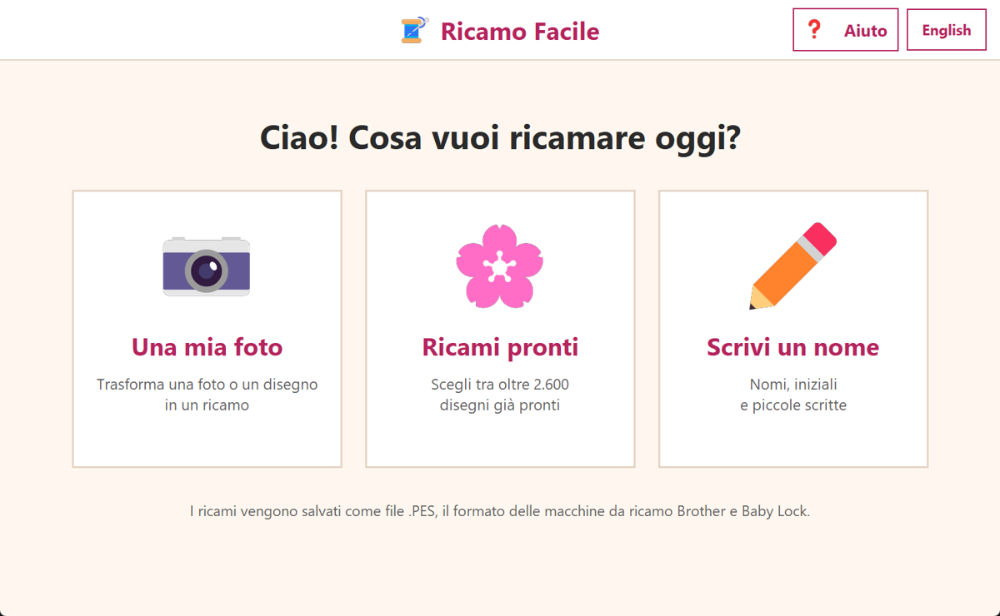
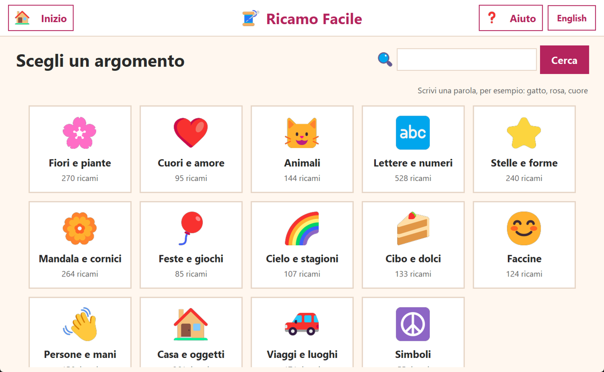
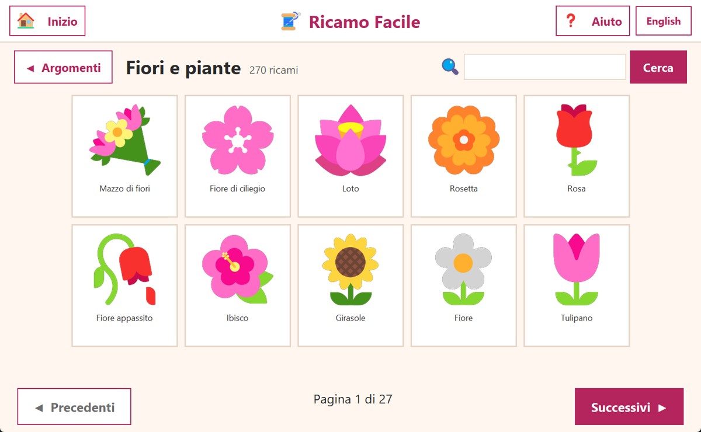
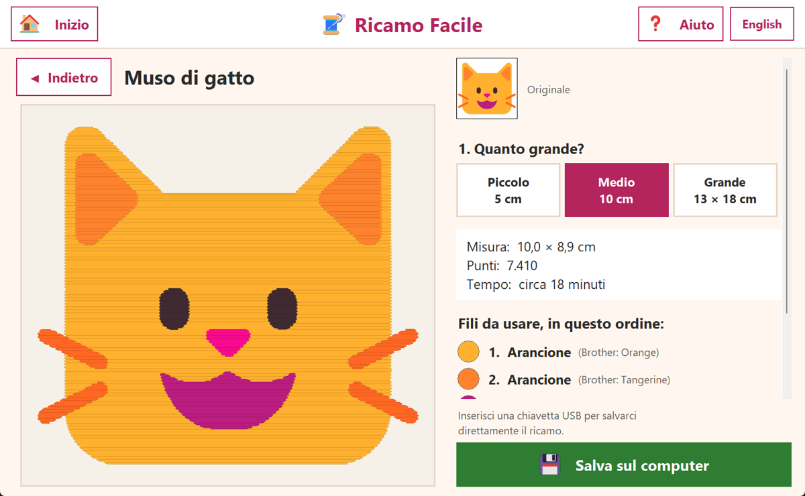
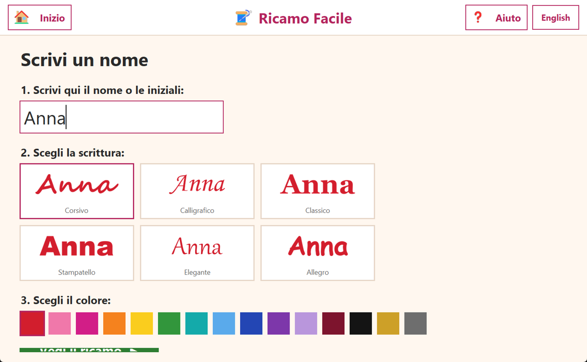

<div align="center">



# Ricamo Facile

**Trasforma foto, disegni e nomi in ricami per la tua macchina da ricamo, in pochi clic.**

🇮🇹 Italiano · [🇬🇧 English](README.en.md)

[**⬇️ Scarica Ricamo Facile per Windows**](https://github.com/Lucosh/ricamo-facile/releases/latest/download/RicamoFacile.exe)

</div>

---

Ricamo Facile è un programma per Windows pensato per chi **non ha dimestichezza con il computer**.
Pulsanti grandi, scritte grandi, poche scelte alla volta e nessuna parola tecnica.
Crea file **.PES**, il formato delle macchine da ricamo **Brother** e **Baby Lock**.

<p align="center">
  
</p>

## Cosa puoi fare

| | |
|---|---|
| 📷 **Una mia foto** | Scegli una foto o un disegno dal computer: il programma la trasforma in ricamo, toglie lo sfondo da solo e ti mostra come verrà, punto per punto. |
| 🌸 **Ricami pronti** | Un catalogo di **oltre 2.500 disegni** divisi in 14 argomenti: fiori, cuori, animali, lettere, mandala, feste, cibo, stagioni e molto altro. Si può anche cercare per parola («gatto», «rosa», «natale»…). |
| ✏️ **Scrivi un nome** | Scrivi un nome o delle iniziali, scegli tra un massimo di 6 tipi di scrittura e 15 colori. |
| 💾 **Salva sulla chiavetta** | Quando inserisci una chiavetta USB, compare un grande pulsante verde per salvarci direttamente il ricamo. |

<p align="center">
  
  
</p>
<p align="center">
  
  
</p>

## Come si installa

1. Clicca su [**Scarica Ricamo Facile per Windows**](https://github.com/Lucosh/ricamo-facile/releases/latest/download/RicamoFacile.exe).
2. Apri il file `RicamoFacile.exe` che hai scaricato. Non serve installare nient'altro.
3. La prima volta Windows potrebbe mostrare un avviso blu («Windows ha protetto il PC»): è normale per i programmi gratuiti senza firma digitale. Clicca su **Ulteriori informazioni** e poi su **Esegui comunque**.

> 💡 Consiglio per chi installa il programma a un genitore o a un nonno: trascina `RicamoFacile.exe` sul Desktop, così basta un doppio clic per aprirlo.

Funziona su **Windows 10 e Windows 11**.

## Come si usa

1. Nella pagina iniziale scegli cosa ricamare: **una tua foto**, **un ricamo pronto** o **un nome**.
2. Scegli quanto grande: **Piccolo** (5 cm), **Medio** (10 cm) o **Grande** (13 × 18 cm).
   A sinistra vedi subito come verrà il ricamo.
3. A destra trovi la **misura**, il **numero di punti**, il **tempo** e l'elenco dei **fili da usare, in ordine**.
4. Inserisci la chiavetta USB e premi il pulsante verde **Salva sulla chiavetta USB**.
5. Inserisci la chiavetta nella macchina da ricamo e scegli il file.

Il pulsante **Aiuto** in alto ripete queste istruzioni in qualsiasi momento, e il pulsante **Inizio** riporta sempre alla prima pagina.

## Consigli per avere ricami belli

- Funzionano meglio le **immagini semplici**: disegni, loghi, fiori, animali stilizzati, con **pochi colori** e uno **sfondo chiaro e uniforme**.
- Le fotografie di volti o paesaggi pieni di dettagli diventano «a macchie di colore»: è un limite del ricamo, non del programma.
- Per le foto puoi scegliere **quanti colori** usare: «Pochi» dà un risultato più pulito, «Tanti» più dettagliato.
- Prova sempre il ricamo su un **ritaglio di stoffa** con lo stabilizzatore prima di ricamare il capo vero.
- Scegli la misura **Grande** solo se la tua macchina ha un telaio da 13 × 18 cm.

## Domande frequenti

**Con quali macchine funziona?**
Con le macchine da ricamo che leggono i file `.PES`: Brother, Baby Lock e molti altri modelli compatibili. Il file è nella versione PES 6 e contiene anche la parte PEC letta direttamente dalle macchine.

**Serve internet?**
No. Il programma funziona completamente senza internet e non invia nessun dato.

**Dove vengono salvate le impostazioni?**
La lingua scelta e le ultime cartelle usate sono in `%APPDATA%\RicamoFacile`. Se qualcosa va storto, lì si trova anche il file `errori.log`.

**I colori dei fili devono essere identici?**
No: accanto a ogni colore trovi un nome semplice (es. «Rosso») e il nome del filo Brother più simile. Puoi usare il filo che preferisci.

---

## Per sviluppatori

### Avviare dal codice

Serve Python 3.10 o più recente su Windows.

```bat
git clone https://github.com/Lucosh/ricamo-facile.git
cd ricamo-facile
pip install -r requirements.txt
python RicamoFacile.pyw
```

### Creare l'eseguibile

```bat
build.bat
```

Crea `dist\RicamoFacile.exe` (un unico file, circa 30 MB) con PyInstaller.

### Test

```bat
pip install -r requirements-dev.txt
python -m pytest
```

### Come funziona la conversione

1. **Colori**: per le foto i colori vengono scelti con *median cut*; per i disegni del catalogo e le scritte vengono presi i colori esatti del disegno, ignorando le sfumature dei bordi.
2. **Sfondo**: i pixel simili al colore del bordo e collegati al bordo vengono tolti; poi il soggetto viene ritagliato e ingrandito fino a riempire il telaio scelto.
3. **Pulizia**: l'immagine viene portata su una griglia di 0,2 mm, un filtro «moda» elimina le macchioline e i colori troppo piccoli per essere cuciti vengono uniti al colore più vicino.
4. **Punti**: ogni colore viene riempito con un **punto pieno (tatami)**: righe ogni 0,4 mm, punti da 3 mm sfalsati, compensazione del tiraggio e catene di righe che si toccano, per ridurre al minimo salti e tagli del filo.
5. **File**: il ricamo viene scritto in PES v6 con [pyembroidery](https://github.com/EmbroidePy/pyembroidery), con punti di fermo all'inizio e alla fine di ogni tratto.

### Struttura del progetto

```
RicamoFacile.pyw           avvio del programma
ricamo_facile/
  app.py                   finestra e schermate (tkinter)
  converter.py             immagine → punti → file .PES
  library.py               catalogo dei ricami e ricerca
  shapes.py                disegni generati: cuori, stelle, fiori, mandala, lettere…
  threads.py               colori dei fili Brother e nomi semplici dei colori
  i18n.py                  testi in italiano e inglese
  data/emoji.json          nomi e categorie delle emoji (IT/EN)
tools/
  build_emoji_db.py        rigenera data/emoji.json dai dati Unicode
  make_icon.py             crea l'icona
  screenshots.py           crea le schermate di questa pagina
tests/                     test automatici
```

### Da dove vengono i ricami del catalogo

- **Circa 1.200 disegni** sono le emoji a colori di Windows (font *Segoe UI Emoji*). Non sono incluse nel programma: vengono disegnate al momento dal font già presente sul computer. Nomi italiani e categorie arrivano dai dati [Unicode CLDR](https://cldr.unicode.org/) ([licenza Unicode](https://www.unicode.org/license.txt)).
- **Circa 1.400 disegni** sono generati dal programma: cuori, stelle, fiori, foglie, mandala, cornici, fiocchi di neve, farfalle, forme geometriche, lettere e numeri in 6 scritture diverse (Monotype Corsiva è presente solo se è installato Microsoft Office), ognuno in più colori.

## Licenza

[MIT](LICENSE): puoi usare, modificare e distribuire liberamente il programma.
